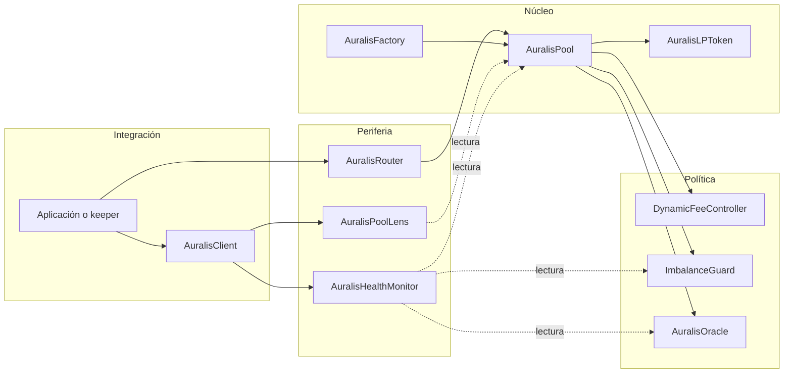

# Auralis AMM Protocol


[](https://github.com/SolguardLabs/AuralisAMMProtocol/actions/workflows/ci.yml)
[](https://github.com/SolguardLabs/AuralisAMMProtocol/releases)
[](https://soliditylang.org/)
[](./LICENSE)

Auralis es una infraestructura AMM de producto constante para mercados de dos activos. El
protocolo combina pools deterministas, participaciones ERC-20, tarifas adaptativas, acumulación
de precio, límites de composición y telemetría operativa en una superficie autocontenida.

La implementación está escrita en Solidity `0.8.26`, no depende de paquetes Solidity externos
y utiliza Foundry para compilación, pruebas, simulación y despliegues reproducibles.

## Capacidades

- Pools canónicos desplegados mediante `CREATE2` para pares no ordenados.
- Swaps `exact-input` con protección de slippage y deadlines.
- Tarifas dinámicas por tamaño, desbalance y volatilidad observada.
- Participaciones ERC-20 con permisos EIP-2612.
- Índices Q128 para distribuir comisiones entre proveedores de liquidez.
- Oracle TWAP con acumuladores Q112 y buffer circular de 64 observaciones.
- Router de uno o varios saltos con verificación de pools canónicos.
- Guardian de emergencia limitado a acciones de pausa.
- Lens para snapshots, cotizaciones y posiciones de fee.
- Monitor operativo con señales de reservas, contabilidad, riesgo y frescura del oracle.
- Cliente TypeScript tipado y desacoplado del proveedor RPC.

## Arquitectura



La factory es el registro canónico. Router, lens y monitor rechazan contratos que no coincidan
con el par registrado, aunque expongan una interfaz compatible.

## Modelo económico

Cada activo mantiene tres dominios contables:

```text
B_i = saldo bruto custodiado
F_i = obligación pendiente frente a LPs
P_i = comisión propiedad del protocolo
R_i = reserva activa de la curva

R_i = B_i - F_i - P_i
```

Las reservas activas alimentan la curva de producto constante:

```text
k = R_in * R_out
amountOut = floor(netAmountIn * R_out / (R_in + netAmountIn))
```

La tarifa total se expresa en partes por millón:

```text
feePpm = clamp(base + size + imbalance + volatility, minimum, maximum)
totalFee = floor(amountIn * feePpm / 1_000_000)
protocolFee = floor(totalFee * protocolSharePpm / 1_000_000)
lpFee = totalFee - protocolFee
```

La emisión de shares usa el menor aporte proporcional y la liquidación descompone cada salida
en principal y fee realizada. Los detalles completos y ejemplos numéricos están en
[docs/accounting.md](./docs/accounting.md).

## Inicio rápido

### Requisitos

- Foundry estable.
- Node.js `22` o posterior.
- Bash para los scripts reproducibles.

```bash
forge --version
node --version
npm --version
```

### Instalación y validación

```bash
git clone https://github.com/SolguardLabs/AuralisAMMProtocol.git
cd AuralisAMMProtocol
npm ci
bash scripts/ci.sh
```

Comandos individuales:

```bash
forge build --sizes --deny warnings
FOUNDRY_PROFILE=ci forge test --deny warnings
npm run ci:client
```

## Ejecución local

Iniciar una red de desarrollo:

```bash
anvil
```

Preparar las variables:

```bash
cp .env.example .env
```

Desplegar factory, controlador de fees e imbalance guard:

```bash
forge script script/DeployAuralis.s.sol:DeployAuralis \
  --rpc-url http://127.0.0.1:8545 \
  --broadcast
```

Crear y capitalizar un pool:

```bash
forge script script/SeedPool.s.sol:SeedPool \
  --rpc-url http://127.0.0.1:8545 \
  --broadcast
```

Las variables, roles y comprobaciones previas se describen en
[docs/operations.md](./docs/operations.md).

## Cliente TypeScript

El cliente recibe una abstracción `PublicClient`, por lo que puede conectarse a viem, ethers o
un adaptador RPC propio sin añadir dependencias en tiempo de ejecución:

```ts
import { AuralisClient, minimumAmount } from "./client/index.js";

const auralis = new AuralisClient(publicClient, {
  factory: "0x...",
  lens: "0x...",
  healthMonitor: "0x...",
});

const pool = await auralis.poolFor(token0, token1);
if (!pool) throw new Error("Pool not found");

const quote = await auralis.quoteSwap(pool, token0, 1_000_000n);
const minimumOut = minimumAmount(quote.amountOut, 50); // 0,50 %
const health = await auralis.health(pool);
```

Consulta [docs/integration.md](./docs/integration.md) para integrar cotizaciones, rutas,
redenciones, monitoring y manejo de unidades.

## Seguridad operativa

El monitor devuelve un bitmap acumulable:

| Bit | Señal                 | Interpretación                                       |
| --: | --------------------- | ---------------------------------------------------- |
| `0` | `PAUSED`              | Operación suspendida por owner o guardian.           |
| `1` | `ACCOUNTING_MISMATCH` | Divergencia entre balances, reservas u obligaciones. |
| `2` | `RESERVE_FLOOR`       | Alguna reserva activa está bajo el mínimo.           |
| `3` | `IMBALANCE`           | La composición excede la política del pool.          |
| `4` | `ORACLE_STALE`        | La última observación supera la edad configurada.    |

Los integradores deben tratar cualquier flag como una señal bloqueante hasta completar su
clasificación. El modelo completo está en [docs/risk-and-monitoring.md](./docs/risk-and-monitoring.md)
y la política de reporte en [SECURITY.md](./SECURITY.md).

## Estructura

```text
client/       Cliente TypeScript y tests de contrato RPC.
docs/         Arquitectura, contabilidad, integración, riesgo y operaciones.
script/       Despliegue y capitalización reproducibles.
scripts/      Entradas de CI para contratos y cliente.
src/
  core/       Factory, deployer y pool.
  fees/       Tarifa adaptativa y configuración por pool.
  interfaces/ Superficies externas estables.
  libraries/  Precisión completa, reservas y settlement.
  monitoring/ Señales operativas agregadas.
  oracle/      Acumuladores y consultas TWAP.
  periphery/  Router y lens.
  risk/       Ancla de composición y límites.
  tokens/     Shares ERC-20 y permisos EIP-2612.
  types/      Structs, constantes y errores.
  utils/      Ownership y guard de reentrada.
tests/
  fuzz/       Propiedades matemáticas.
  invariant/  Reconciliación persistente.
  unit/       Comportamiento funcional y rechazos.
```

## Documentación

- [Arquitectura](./docs/architecture.md)
- [Modelo contable](./docs/accounting.md)
- [Integración](./docs/integration.md)
- [Operaciones](./docs/operations.md)
- [Riesgo y monitoring](./docs/risk-and-monitoring.md)
- [Política de seguridad](./SECURITY.md)
- [Contribución](./CONTRIBUTING.md)
- [Historial de cambios](./CHANGELOG.md)

## Licencia

Publicado bajo licencia [MIT](./LICENSE).
