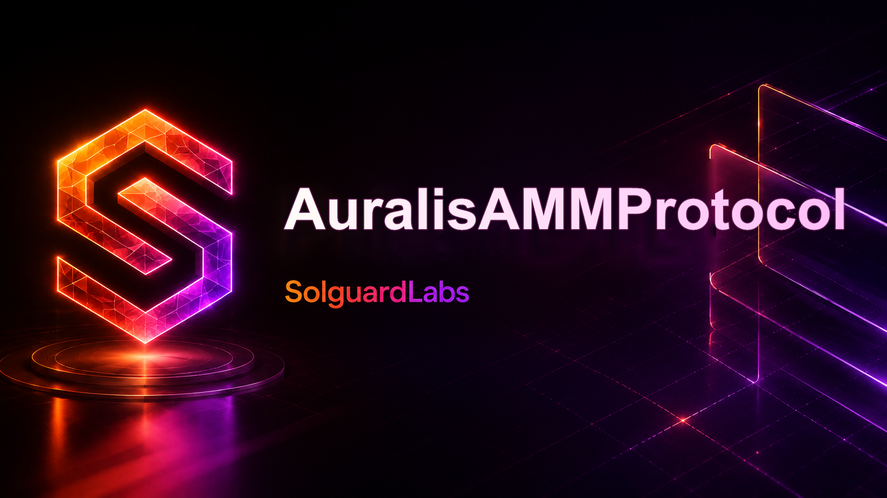

# Auralis AMM Protocol



Auralis es un protocolo AMM de producto constante para pools de dos activos. La
implementacion separa el principal utilizable del pool, las comisiones devengadas por los
proveedores de liquidez y las comisiones asignadas al protocolo. Sobre esa base ofrece
participaciones ERC-20, swaps con fee adaptativa, observaciones de precio y controles contra
desbalances extremos.

El repositorio esta pensado como una base autocontenida para revision de contratos, pruebas
economicas y simulacion local con Foundry. No requiere servicios externos para compilar o
ejecutar la suite.

## Componentes Principales

- `AuralisFactory`: despliegue determinista y registro canonico de pools por par.
- `AuralisPool`: custodia, swaps, emision y quema de participaciones y contabilidad de fees.
- `AuralisRouter`: entradas con deadlines, limites de slippage y rutas de varios saltos.
- `DynamicFeeController`: fee base con ajustes por tamano, desbalance y volatilidad.
- `AuralisOracle`: acumulador circular de precios y consultas TWAP.
- `ImbalanceGuard`: bandas de reserva normalizadas respecto al ratio de apertura.
- `AuralisPoolLens`: vistas agregadas para integradores, simuladores e interfaces.

## Modelo Economico

Cada pool mantiene tres capas contables por activo:

1. Reserva bruta custodiada por el contrato.
2. Obligaciones por comisiones de LP y comisiones de protocolo.
3. Reserva activa utilizada por el invariante de producto constante.

Las participaciones representan una fraccion del principal activo. Las comisiones de LP se
distribuyen mediante indices acumulativos por share y checkpoints por cuenta, de modo que los
derechos ya devengados permanecen asociados a su titular cuando se transfieren participaciones.

La fee de cada swap se expresa en partes por millon. El controlador combina una base con
recargos acotados por tamano de orden, desviacion del ratio ancla y volatilidad observada. El
pool valida ademas que la operacion proyectada permanezca dentro de sus bandas de reserva.

## Requisitos

- Foundry estable con Solidity `0.8.26`.
- Bash para ejecutar los scripts de validacion.

Comprobar la instalacion:

```bash
forge --version
```

## Compilacion

```bash
forge build
```

Foundry descargara el compilador configurado la primera vez que sea necesario.

## Pruebas

Ejecutar la suite publica:

```bash
forge test
```

Ejecutar con trazas detalladas:

```bash
forge test -vvv
```

Ejecutar la validacion equivalente a CI:

```bash
bash scripts/ci.sh
```

## Despliegue Local

Iniciar una red de desarrollo:

```bash
anvil
```

En otra terminal, desplegar los componentes base:

```bash
forge script script/DeployAuralis.s.sol:DeployAuralis \
  --rpc-url http://127.0.0.1:8545 \
  --broadcast
```

Las direcciones desplegadas se emiten como eventos del script y quedan registradas en los
artefactos locales de Foundry.

## Estructura

```text
src/
  core/         Factory y pool de producto constante.
  fees/         Configuracion y cotizacion de fees adaptativas.
  interfaces/   Superficies externas del protocolo.
  libraries/    Matematica de precision completa y transferencias seguras.
  oracle/       Historial circular y consultas de precio.
  periphery/    Router y vistas agregadas.
  risk/         Validacion de composicion de reservas.
  tokens/       Implementacion de las participaciones del pool.
  utils/        Control de acceso y proteccion de reentrada.
tests/
  helpers/      Infraestructura compartida de pruebas.
  mocks/        Activos deterministas para entorno local.
  unit/         Flujos funcionales y rechazos de politica.
  fuzz/         Propiedades matematicas sobre rangos amplios.
  invariant/    Reconciliacion de balances y estado persistente.
script/         Despliegues reproducibles de Foundry.
scripts/        Entradas de test y CI local.
```

## Integracion

Los integradores deben obtener pools desde la factory y no aceptar direcciones aportadas por
usuarios sin verificar. Toda operacion economica admite limites de salida o de activos, y los
clientes deben fijarlos a partir de una cotizacion reciente. Los deadlines protegen frente a
ejecucion tardia, pero no sustituyen un limite de slippage adecuado.

Los tokens con rebases, callbacks no estandar o comisiones sobre transferencia no forman parte
del modelo soportado. El pool exige que el importe recibido coincida con el solicitado.

## Estado

Auralis es un laboratorio tecnico para auditoria y validacion local. No ha sido sometido a una
auditoria de produccion y no debe custodiar activos reales ni desplegarse sin endurecimiento,
revision independiente y pruebas adicionales sobre la red de destino.

