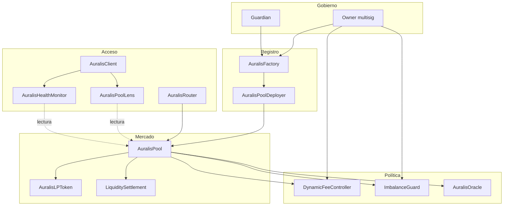
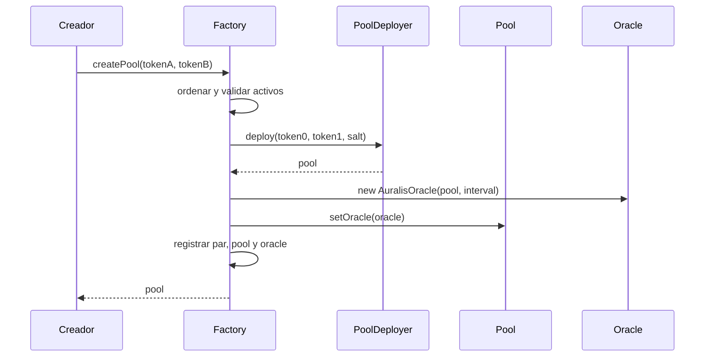

# Arquitectura

## Visión general

Auralis separa custodia, ejecución, política y observabilidad. El pool conserva el estado
económico mínimo; la factory mantiene la identidad canónica; los controladores parametrizan
riesgo y fees; router, lens, monitor y cliente forman la capa de integración.



## Registro canónico

La factory ordena las direcciones de los dos activos y calcula:

```text
token0 = min(tokenA, tokenB)
token1 = max(tokenA, tokenB)
salt = keccak256(token0 || token1)
```

`AuralisPoolDeployer` utiliza el salt con `CREATE2`. La factory registra el pool en ambos órdenes
y despliega su oracle. Esta secuencia permite predecir la dirección sin admitir dos mercados
para el mismo par.



## Pool

`AuralisPool` agrupa cinco responsabilidades acotadas:

1. Custodiar ambos ERC-20 y rechazar transferencias con importe efectivo inesperado.
2. Mantener reservas brutas y obligaciones segregadas.
3. Emitir, transferir y quemar shares.
4. Cotizar y ejecutar swaps después de aplicar fee y política de composición.
5. Actualizar el oracle y emitir eventos de reconciliación.

Las operaciones con activos utilizan `ReentrancyGuard`. Los cambios de balance de shares llaman
al checkpoint de fees antes de escribir el nuevo saldo.

## Política de fees

`DynamicFeeController` recibe la dirección del pool, dirección del swap, importe y reservas.
Compone la tarifa con valores acotados:

```text
fee = base + sizeSurcharge + imbalanceSurcharge + volatilitySurcharge
fee = clamp(fee, minimumFee, maximumFee)
```

Una configuración por pool puede sustituir los valores globales. Si la fuente de volatilidad no
está disponible, la cotización continúa con los componentes verificables y permanece dentro de
los límites.

## Riesgo de composición

`ImbalanceGuard` almacena el ratio de la primera aportación como ancla inmutable. Antes de una
transición, normaliza las reservas proyectadas respecto al ancla y calcula la desviación
simétrica. La política también aplica un suelo absoluto por activo.

## Oracle

El oracle usa acumuladores Q112 y un buffer circular de 64 posiciones. El pool es el único
emisor de observaciones. `consult` calcula TWAP sobre una ventana histórica y `volatility`
estima movimiento medio entre intervalos.

## Periferia

- `AuralisRouter`: aporta o retira liquidez y ejecuta rutas exact-input.
- `AuralisPoolLens`: agrega snapshots, posiciones, cotizaciones y riesgo sin escribir estado.
- `AuralisHealthMonitor`: convierte estado distribuido en señales operativas bitmapped.
- `AuralisClient`: adapta estas lecturas a una interfaz TypeScript tipada.

La periferia verifica que `pool.factory()` y `factory.getPool(token0, token1)` coincidan con la
dirección recibida. Una interfaz compatible no basta para ser tratada como canónica.

## Límites de módulos

| Módulo             | Escribe estado económico | Mueve activos |    Autoridad administrativa |
| ------------------ | -----------------------: | ------------: | --------------------------: |
| Factory            |                 Registro |            No |            Owner y guardian |
| Pool               |                       Sí |            Sí | Factory para pausa y oracle |
| Fee controller     |                 Política |            No |                       Owner |
| Imbalance guard    |                 Política |            No |                       Owner |
| Oracle             |            Observaciones |            No |                   Solo pool |
| Router             |       Estado transitorio |            Sí |                     Ninguna |
| Lens               |                       No |            No |                     Ninguna |
| Health monitor     |                       No |            No |                     Ninguna |
| Cliente TypeScript |                       No |            No |                     Ninguna |
