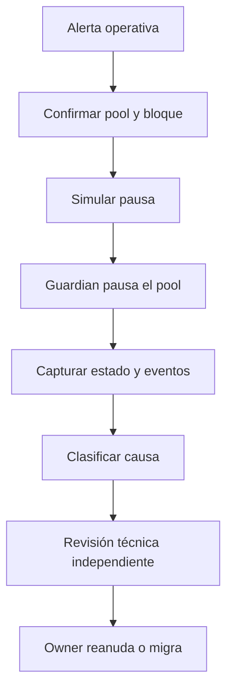

# Operaciones

## Roles

| Rol                      | Capacidades                                              | Restricción recomendada   |
| ------------------------ | -------------------------------------------------------- | ------------------------- |
| Owner de factory         | Fee controller, receptor, guardian, oracle y reanudación | Multisig y timelock       |
| Owner de fee controller  | Parámetros globales y por pool                           | Multisig de riesgo        |
| Owner de imbalance guard | Suelos y bandas de composición                           | Multisig de riesgo        |
| Guardian                 | Pausar creación o pools                                  | Cuenta operativa separada |
| Receptor de fees         | Recibir fees de protocolo                                | Tesorería sin privilegios |

El guardian no puede reanudar operaciones. El receptor de fees no necesita permisos
administrativos.

## Preparación

1. Selecciona el release y registra su commit.
2. Ejecuta `npm ci` y `bash scripts/ci.sh`.
3. Verifica el bytecode y los tamaños con `forge build --sizes`.
4. Define owner, guardian y receptor de fees.
5. Valida chain ID, RPC y política de gas.
6. Copia `.env.example` a `.env` sin versionarlo.

```bash
cp .env.example .env
```

Variables de despliegue:

| Variable                      | Uso                                |
| ----------------------------- | ---------------------------------- |
| `PRIVATE_KEY`                 | Firmante administrado por Foundry. |
| `AURALIS_ADMIN`               | Owner inicial de los componentes.  |
| `AURALIS_GUARDIAN`            | Rol de pausa.                      |
| `PROTOCOL_FEE_RECIPIENT`      | Tesorería receptora.               |
| `ORACLE_OBSERVATION_INTERVAL` | Intervalo mínimo de observación.   |

## Despliegue base

Simulación:

```bash
forge script script/DeployAuralis.s.sol:DeployAuralis \
  --rpc-url "$RPC_URL"
```

Broadcast:

```bash
forge script script/DeployAuralis.s.sol:DeployAuralis \
  --rpc-url "$RPC_URL" \
  --broadcast \
  --verify
```

El evento `AuralisDeployed` contiene factory, fee controller, imbalance guard y roles. Conserva
el receipt, argumentos de constructor, bytecode y commit en el registro de despliegue.

## Crear un pool

Variables adicionales:

| Variable               | Uso                             |
| ---------------------- | ------------------------------- |
| `AURALIS_FACTORY`      | Factory canónica.               |
| `TOKEN_A`, `TOKEN_B`   | Activos del par.                |
| `AMOUNT_A`, `AMOUNT_B` | Aporte en unidades mínimas.     |
| `LP_RECIPIENT`         | Titular de shares.              |
| `DEADLINE_WINDOW`      | Validez de la aportación.       |
| `VOLATILITY_WINDOW`    | Ventana de política adaptativa. |

Antes de capitalizar:

- confirma dirección, símbolo, decimales y bytecode de ambos activos;
- descarta rebases y comisiones sobre transferencia;
- calcula el ratio inicial y la banda de composición;
- simula la transacción desde el firmante real;
- configura mínimos económicos fuera del script si la política lo exige.

## Configuración posterior

Orden recomendado:

1. Verificar que la factory reconoce el pool en ambos órdenes.
2. Verificar el oracle y su asociación con el pool.
3. Configurar fee controller y policy del imbalance guard.
4. Desplegar lens y health monitor con la factory correcta.
5. Ejecutar un snapshot y confirmar la reconciliación inicial.
6. Registrar direcciones en el cliente y el indexador.
7. Transferir ownership al multisig o timelock definitivo.

## Runbook de pausa



Durante una pausa:

- bloquea automatizaciones de swap y aportación;
- conserva acceso de lectura a lens, monitor e indexador;
- registra el bloque de la señal y el bloque de la pausa;
- evita cambiar varios parámetros simultáneamente;
- exige una revisión independiente antes de reanudar.

## Rotación de roles

La transferencia de ownership es de dos pasos:

1. El owner actual propone `pendingOwner`.
2. La cuenta propuesta acepta.

Verifica que la cuenta de destino pueda ejecutar la aceptación antes de iniciar la rotación. La
rotación del guardian es inmediata y debe coordinarse con las alertas operativas.

## Release

Los releases siguen SemVer:

```text
vMAJOR.MINOR.PATCH
```

La automatización comprueba que el tag coincida con `package.json`. Un release debe incluir:

- resumen de cambios;
- commit y tag;
- resultado de contratos y cliente;
- cambios de almacenamiento o ABI;
- instrucciones de migración cuando proceda.

## Recuperación

Auralis no incorpora una ruta administrativa para extraer reservas de LP. Ante una incidencia,
la respuesta depende de pausa, análisis, migración coordinada y acciones explícitas de los
usuarios. No añadas puertas de custodia temporal a una versión desplegada.
