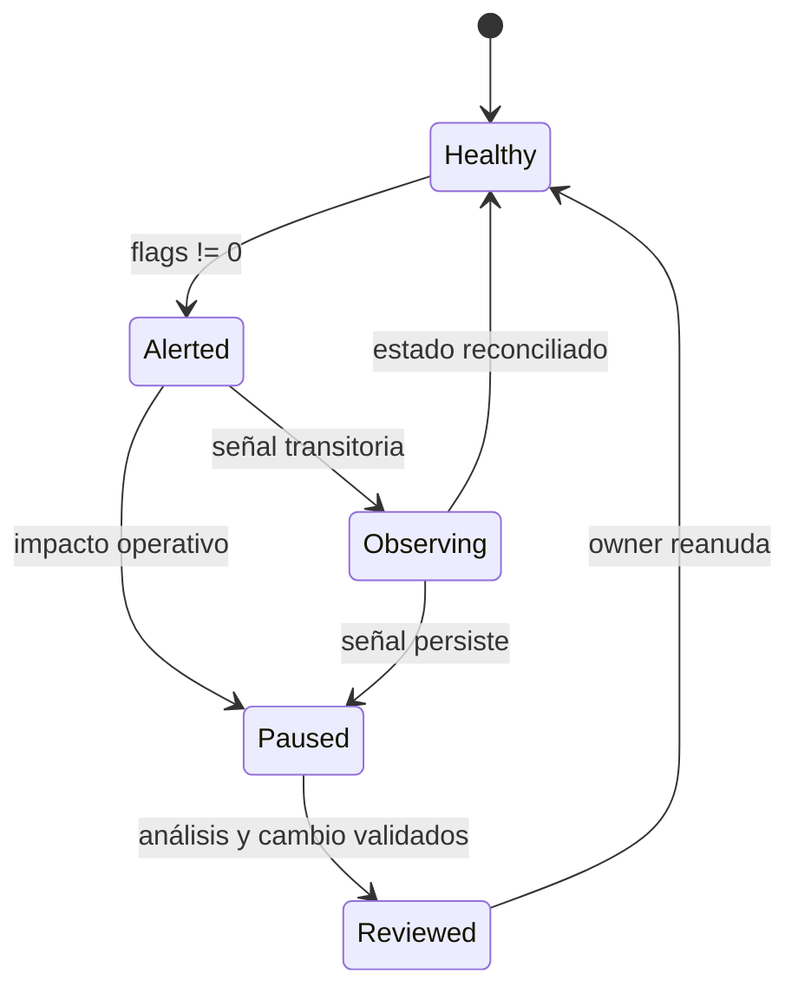

# Riesgo Y Monitoring

## Objetivo

La capa de riesgo evita transiciones que dejan una composición extrema y la capa de monitoring
detecta divergencias de estado. Son funciones distintas: el guard bloquea antes de escribir; el
monitor clasifica el estado observable después de cada bloque.

## Ancla de composición

La primera aportación define:

```text
anchor0 = initialReserve0
anchor1 = initialReserve1
```

Para reservas proyectadas:

```text
normalized0 = reserve0 * Q96 / anchor0
normalized1 = reserve1 * Q96 / anchor1
imbalancePpm = abs(normalized0 - normalized1) * 1_000_000
               / (normalized0 + normalized1)
```

La transición se acepta si ambas reservas superan el mínimo y `imbalancePpm` no excede la banda
del pool.

## Tarifa adaptativa

El fee controller incrementa el coste cuando aumenta tamaño, desbalance o volatilidad:

```text
sizeComponent = f(amountIn / reserveIn)
imbalanceComponent = f(projectedRatio / anchorRatio)
volatilityComponent = f(observedVolatility)
```

Cada componente está acotado y la suma final se restringe a `[minimumFee, maximumFee]`. El
protocol share se aplica después de calcular la fee total.

## Health flags

| Máscara | Nombre                     | Condición                              | Acción inicial                 |
| ------: | -------------------------- | -------------------------------------- | ------------------------------ |
|     `1` | `FLAG_PAUSED`              | Pool en pausa                          | Detener escrituras             |
|     `2` | `FLAG_ACCOUNTING_MISMATCH` | Balance, reserva u obligación divergen | Reconciliar por bloque         |
|     `4` | `FLAG_RESERVE_FLOOR`       | Reserva activa bajo mínimo             | Bloquear rutas dependientes    |
|     `8` | `FLAG_IMBALANCE`           | Política rechaza la composición        | Revisar liquidez y flujo       |
|    `16` | `FLAG_ORACLE_STALE`        | Observación demasiado antigua          | Invalidar precios dependientes |

Los flags se combinan con OR bit a bit. `healthy` solo es `true` cuando `flags == 0`.

## Frecuencia

Recomendación orientativa:

- Pool con actividad: inspección por bloque o por evento `Sync`.
- Pool sin actividad: inspección periódica inferior a `maximumOracleAge`.
- Roles: alerta inmediata ante cualquier evento administrativo.
- Oracle: alerta preventiva al 75 % de la edad máxima.

## Eventos

| Evento                  | Métrica derivada                       |
| ----------------------- | -------------------------------------- |
| `Mint`                  | Entrada de principal y shares emitidas |
| `Burn`                  | Salida de activos y shares destruidas  |
| `Swap`                  | Volumen, output y separación de fees   |
| `Sync`                  | Punto de reconciliación de reservas    |
| `FeeGrowthUpdated`      | Cambio de índice y pasivo pendiente    |
| `FeesClaimed`           | Realización de obligación LP           |
| `ProtocolFeesCollected` | Transferencia a tesorería              |
| `PauseStateUpdated`     | Cambio de disponibilidad               |

## Reconciliación externa

Por cada `Sync`:

```text
balance(token0, pool) == grossReserve0
balance(token1, pool) == grossReserve1
grossReserve0 == activeReserve0 + obligations0
grossReserve1 == activeReserve1 + obligations1
```

Conserva también el supply de shares y los acumuladores globales. Las diferencias deben
clasificarse antes de corregir datos del indexador.

## Señales derivadas

Un sistema externo puede calcular:

```text
reserveCoverage_i = activeReserve_i / grossReserve_i
feeLiabilityRatio_i = pendingLPFee_i / grossReserve_i
spotToAnchor = spotPrice / anchorPrice
oracleFreshness = blockTimestamp - latestObservation
```

Las alertas deben usar ventanas y umbrales por pool; un valor absoluto común para todos los
activos puede generar falsos positivos.

## Respuesta



No automatices la reanudación. La desaparición de un flag es evidencia operativa, pero no
sustituye la revisión de la causa que originó la alerta.
